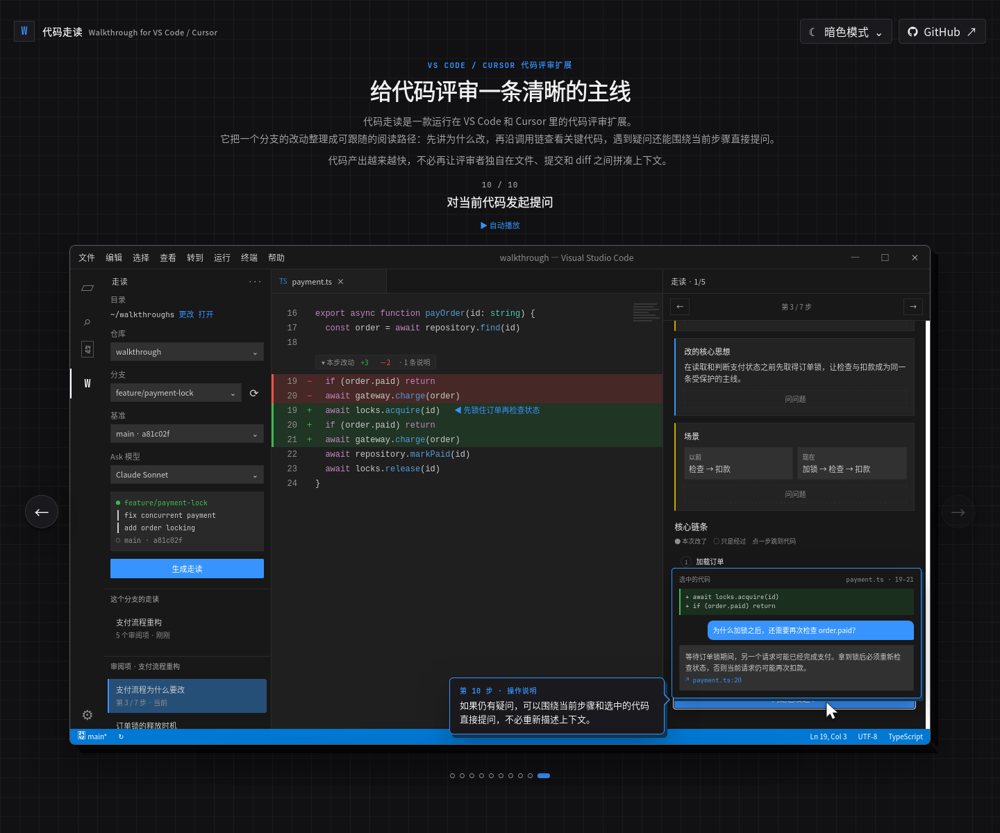

# 代码走读（walkthrough）

带着人一步步审一次代码改动的 VS Code / Cursor 插件。

一份「走读」把一个分支的改动拆成几件要审的事。每件事先讲清 **修改原因** 和 **改的核心思想**，再给一个具体 **场景**（以前怎样、现在怎样），最后沿着真实的调用链条，从入口一步步走到落库：每一步打开只读的代码快照，标出哪里新增、修改、删除，每处改动配一句说明。看不懂的地方可以就地问 AI。

走读可以选一个分支让 AI 生成，也可以打开别人生成好的走读文件。

[](https://hedykan.github.io/walkthrough/)

点击图片打开交互演示。使用编辑器两侧的圆形箭头、键盘 `←` / `→`，或启动自动播放，沿着「为什么改 → 核心思路 → 具体场景 → 调用链 → 就地提问」走一遍。最后一步会展示问题怎样自动带上当前代码和走读上下文。

## 为什么做这个

现在写代码越来越快了。

有了 AI 之后，一次改动很容易就从几十行变成几百行，甚至一下产出十几个文件。代码生成的速度上去了，但人理解代码的速度没有同步变快。以前还能从头到尾认真看完一个 diff，现在经常是改动刚写完，下一批代码又已经来了。

一开始我以为，只要 diff 写得清楚、提交拆得细一点，Review 应该还能跟得上。实际用下来发现并不是这样。

当改动比较大时，直接把一整片 diff 摊在眼前，人很容易陷进细节里：

- 不知道应该先看哪个文件；
- 看到了某一行变化，却不知道它为什么要改；
- 顺着调用跳了几次，就忘了最初在验证什么；
- 每一小段似乎都合理，但整条业务链路是否成立，反而没有看清楚；
- 最后 Review 很容易退化成扫一遍代码风格和明显错误。

问题不只是“代码太多”，而是缺少一条能带人理解改动的主线。

所以我做了「代码走读」。

它不是简单地把 diff 换一种样式展示，也不是让 AI 替人完成 Review。它更像是让写代码的人带着 Review 的人走一遍这次改动：

1. 为什么要改；
2. 核心思路是什么；
3. 在一个具体场景里，以前会怎样，现在会怎样；
4. 请求从哪里进入；
5. 中间经过哪些关键判断；
6. 最后在哪里产生结果或落库。

走读会沿着这条主线，一步一步打开对应版本的代码快照和 diff。每一步只关注当前需要理解的部分，同时保留它在整个调用链中的位置。遇到不明白的地方，也可以直接对着这一段代码提问。

我希望它解决的不是“怎样更快地看完所有代码”，而是“怎样先抓住这次改动最重要的逻辑，再有目的地检查细节”。

AI 让代码产出越来越快，人依然需要对最终结果负责。既然我们很难再靠从第一行看到最后一行来获得信心，那就需要一种更接近讲解、推演和验证的 Review 方式。

先沿着主线把故事讲明白，再去判断这个故事是否真的成立。

## 能做什么

- 按分支、对比基准和提交范围生成结构化代码走读
- 沿真实调用链逐步打开只读快照和 diff，不改动工作区
- 在面板或选中的代码旁向 Claude Code / Codex 提问
- 把走读保存成普通 JSON，方便团队通过 Git 共享
- 支持未提交改动和 Git worktree

---

## 安装

从 [GitHub Releases](https://github.com/hedykan/walkthrough/releases) 下载最新的 `walkthrough-<版本>.vsix`。

### Cursor

**命令行**

```bash
cursor --install-extension ~/Downloads/walkthrough-0.1.8.vsix
```

**界面**：`Cmd+Shift+P`（Windows / Linux 是 `Ctrl+Shift+P`）→ 输入 `Extensions: Install from VSIX...` → 选中 vsix 文件。

### VS Code

**命令行**

```bash
code --install-extension ~/Downloads/walkthrough-0.1.8.vsix
```

**界面**：左侧「扩展」视图 → 右上角 `…` → `从 VSIX 安装...`（Install from VSIX...）→ 选中 vsix 文件。

### 命令行提示找不到 `cursor` / `code`

在编辑器里按 `Cmd+Shift+P`：

- Cursor：运行 `Shell Command: Install 'cursor' command in PATH`
- VS Code：运行 `Shell Command: Install 'code' command in PATH`

然后重开终端。

### 装完之后

`Cmd+Shift+P` → `Developer: Reload Window` 重载窗口，左侧活动栏会多一个「代码走读」图标。

### 升级、卸载

- **升级**：用同样的命令安装新版本的 vsix，会直接覆盖旧版。
- **卸载**：`cursor --uninstall-extension hedykan.walkthrough`（VS Code 把 `cursor` 换成 `code`），或者在扩展视图里找到「代码走读」点卸载。

---

## 使用前提

| 想做什么 | 需要 |
|:--|:--|
| 看走读 | 本机有对应的 git 仓库（插件从 git 里读那个提交的代码，不动你的工作区） |
| 问问题、生成走读 | 另外还要装好并登录 [Claude Code](https://claude.com/claude-code)（`claude` 命令）；也可以改用 `codex` |

问问题和生成走读用的是**你自己**的 claude / codex 账号，代码只会发给你自己的 AI 账号。AI 只有只读权限：只能读文件和执行 `git show / log / diff`，不能改文件。

---

## 首次配置

### 选走读目录

走读文件（生成的走读、问答记录）都存在一个目录里。第一次打开左侧「代码走读」视图时，最上面会提示你选：

```
目录  ~/walkthroughs            更改  打开
还没选走读目录：生成的走读会存到 ~/walkthroughs
[选择目录]  [就用这个]
```

- **选择目录**：选一个文件夹，可以当场新建。团队有共享的走读仓库时，选你 clone 下来的那个目录。
- **就用这个**：用默认的 `~/walkthroughs`。
- 以后随时可以点「更改」换目录，点「打开」在访达（Finder）里打开它。

### 其他设置

打开设置（`Cmd+,`），搜索 `walkthrough`。一般不用改，按需调整：

| 设置 | 默认值 | 说明 |
|:--|:--|:--|
| `walkthrough.dataDir` | `~/walkthroughs` | 走读目录，左侧「目录」那一行改的就是它 |
| `walkthrough.repoRoots` | 空 | 仓库名 → 本地路径。不填时插件先按工作区里的目录名去找，找不到会让你选一次，之后记住 |
| `walkthrough.baseBranch` | 空 | 每个仓库固定用哪个分支当对比基准。不填时依次找 `origin/main` → `origin/master` → `origin/dev` |
| `walkthrough.ask.model` | 空 | 生成走读和所有问答统一使用的模型，左侧「模型」下拉改的就是它 |
| `walkthrough.ask.models` | 空 | 自定义本地 Agent；通常直接点左侧「模型」旁的 `＋` 添加，不用手写 |

也可以直接写进 `settings.json`：

```json
{
  "walkthrough.dataDir": "~/walkthroughs",
  "walkthrough.repoRoots": {
    "loloyal-services-be": "~/Develope/loloyal/loloyal-services-be"
  },
  "walkthrough.baseBranch": { "loloyal-services-be": "origin/main" }
}
```

---

## 使用

### 1. 选范围：左侧「代码走读」视图

```
仓库  [loloyal-services-be ▾]
分支  [hotfix/metafield-partial…]  ⟳
对比  [origin/main            ]  分叉 dc134417
模型  [codex-gpt-6.1-sol ▾]  ＋
提交（origin/main 分叉后 1 个）
 ● 98475290 fix(metafield): 已删除顾客不再…   📖
 ○ dc134417 ── origin/main 分叉点 ──
[ 生成走读 ]
```

- **分支**、**对比**：点进去会列出全部分支，输入关键字筛选；`↑ ↓` 选择，回车确定。点 `⟳` 拉取远端新建的分支（`git fetch --prune origin`，不动工作区）。
- **模型**：这个选择同时用于生成走读、面板问答和编辑器快速问答。内置 Claude 与多个 Codex 模型；自定义模型的添加和删除见下文。
- **提交列表**：默认范围是从分叉点到分支最新提交。**点一下**设为终点，**Shift + 点**设为起点，**双击**只看这一个提交。
- 分支已经合进主干时，没有独有的提交，列表会显示它最近的 100 个提交，由你自己点选范围。
- 已经生成过走读的范围会显示 📖，可以直接打开。
- 下面的「这个分支的走读」列出这个分支以前生成过的所有走读（不管当时选的是哪个范围），按时间从新到旧排，点一下就打开。鼠标移到某一行，右边会出现 `×`：点了会弹窗确认，确认后走读和它的问答记录一起放进废纸篓（删错了能从废纸篓找回）。

#### 选择、添加和删除模型

在「模型」下拉里选一次，后续的走读生成、面板问答和编辑器快速问答都会使用它。

- **使用内置模型**：直接选择 Claude、`codex-默认` 或一个 Codex 模型。`codex-默认` 跟随本机 Codex 配置。
- **添加其他 Codex 模型**：点模型右侧的 `＋` →「添加 Codex 模型」→ 输入 Codex CLI 支持的模型 ID。
- **添加本地 Agent**：点 `＋` →「添加本地 Agent」→ 填显示名称和命令参数数组。命令不会经过 shell；插件从 stdin 传入完整提示词，并把 stdout 当作回答。
- **删除自定义模型**：点 `＋` →「删除自定义模型」→ 选择要删除的条目。内置模型不会出现在删除列表里。

例如添加 Pi Agent：

```json
["pi", "--print", "--no-session"]
```

如果 Pi 的默认模型不可用，可以先运行 `pi --list-models` 查看本机模型，再固定一个：

```json
["pi", "--print", "--no-session", "--model", "minimax/MiniMax-M2.7-highspeed"]
```

添加前建议先在终端验证同一条命令，例如：

```bash
printf '只回复 OK\n' | pi --print --no-session --model minimax/MiniMax-M2.7-highspeed
```

### 还没提交的改动

选的分支正检出在本地（主检出或某个 worktree），并且有没提交的改动时，提交列表最上面会多一行：

```
 ◆ 工作区（未提交）· 36 个文件
 ○ 18927c6a ── origin/main 分叉点 ──
```

默认终点就是它，也就是已提交的加上未提交的；**双击**它就只看没提交的部分。生成前会列出要拍进快照的文件，请你确认一遍，像本地 `.env` 这种不想让 AI 看到的文件，可以在这一步发现。

确认后插件会给工作区拍一张「快照提交」：它和普通提交一样，但**不挂在任何分支上**，只挂在隐藏引用 `refs/walkthrough/<分支>-<时间>` 下。你的分支、暂存区、工作区都不会变，`git push` 也不会把它推上去。走读里的行号以这张快照为准，你之后继续改代码，走读也不会乱。

- 快照只在本机，把这份走读发给别人，对方找不到这个提交。要分享，请先正常提交、push，再生成一次。
- 查看和清理快照：`git for-each-ref refs/walkthrough/`、`git update-ref -d refs/walkthrough/<名字>`。
- 用 worktree 开发也一样：选它检出的那个分支就行，插件会自己找到 worktree 目录。

### 2. 生成走读

点「生成走读」：

1. AI 先读提交和 diff，**列出要审的几件事**。你可以勾掉不用审的、改改标题，然后点「开始生成」。
2. 每件事单独生成，左侧显示进度（排队 → 正在查看哪个文件 → 完成）。
3. 插件会按真实的 git diff 校验每一步的位置和行号。不合格的交回 AI 修正，最多两轮。
4. 完成后自动保存到走读目录并打开。

规模和 PR #2606 差不多的分支，大约需要 5–10 分钟，随时可以取消。

### 3. 看走读：右侧面板

用 `Alt+]` / `Alt+[`（或面板顶部的按钮）按这个顺序往下走，走到哪一块，就把它滚到屏幕正中：

```
修改原因 → 改的核心思想 → 场景（以前 / 现在）→ 链条第 1 步 → 第 2 步 → … → 下一件事
```

- 面板顶部显示当前位置，例如「第 1/5 项 · 核心思想」「第 1/5 项 · 第 3/7 步」。
- 点任意一段说明，就从那里接着走；点链条里的某一步，就跳到那一步。
- 走到链条的每一步，左边编辑器打开那一版的代码：有改动的步骤显示 diff（修改前 ↔ 修改后），每处改动的说明挂在行尾。
- 每一步下面的「▸ 本步改动」默认收起，想对着说明逐行看时再点开。

### 4. 问问题

- **面板里**：每一段最下面都有「问问题」，回答会显示在那一段里，并保存在走读文件旁边的 `.answers.json` 中，别人打开这份走读也能看到。
- **编辑器里**：在快照代码上选中几行，点行号旁边的 `+`，就地提问。这种快速问答不保存，关掉就没了。
- 回答里的代码引用可以点，点了会跳到那几行，并把这句话挂在代码旁边当说明。**按住 Alt 点**是就地预览，不跳走。
- 跳过去之后，面板顶部会出现路径，比如 `第 5 步 › fusion.go:168 › sink.go:290`。点任意一段可以回去，`Alt+←` 回到上一处。

### 快捷键

| 快捷键 | 作用 |
|:--|:--|
| `Alt+]` | 下一步 |
| `Alt+[` | 上一步 |
| `Alt+\` | 回到当前步（看完引用、关掉快速问答之后） |
| `Alt+←` | 回到上一处引用（只在走读快照或走读面板里生效） |

---

## 分享走读

走读就是普通的 JSON 文件：`<走读目录>/<仓库名>/code/<base 前 8 位>..<head 前 8 位>.json`，问答记录在同名的 `.answers.json` 里。

- **团队共享**：建一个私有的走读仓库，每人 clone 下来，在左侧「目录」里选中它。生成完 push，别人 pull 下来就能在左侧看到 📖。
- **临时发给某个人**：直接发 JSON 文件。对方在命令面板运行 `走读: 打开走读`，选中这个文件即可。

---

## 常见问题

**打开走读时提示「本地仓库没有提交 xxxxxxxx」**
你本地还没拉到这个提交。点弹窗里的 `git fetch origin <分支>`，或者自己在仓库里执行 `git fetch`。

**分支列表里找不到某个分支**
点分支框右边的 `⟳` 拉取远端分支。

**提交列表是空的**
多半是对比基准选得不对。比如分支是从 `dev` 拉出来的，对比却选了 `origin/main`。在「对比」里换成它真正的基准分支。

**问问题没反应或者报错**
先在终端确认 `claude -p "hi"` 能正常回答。用 codex 的话，确认 `codex exec "hi"` 能跑通。

**回答太慢**
在左侧「模型」里换一个更快的模型，比如 `claude-haiku` 或更轻量的 Codex 模型。

---

## 开发

需要 Node.js 22+ 和 pnpm。

```bash
pnpm install
pnpm typecheck
pnpm test
pnpm build
```

生成可安装的 VSIX：

```bash
pnpm package
```

构建产物会写入 `dist/`，VSIX 会写入 `release/`。

## 数据与权限

- 查看走读时，插件只从本机 Git 仓库读取指定提交的内容。
- 生成走读或提问时，插件调用你本机已经登录的 Claude Code 或 Codex；代码会按对应工具和账号的配置发送给模型服务。
- AI 命令默认只有读文件及执行 `git show`、`git log`、`git diff` 的权限。
- 走读和持久问答记录保存在你配置的本地走读目录中。

## 许可证

当前源码未授予开源许可证。保留所有权利。
